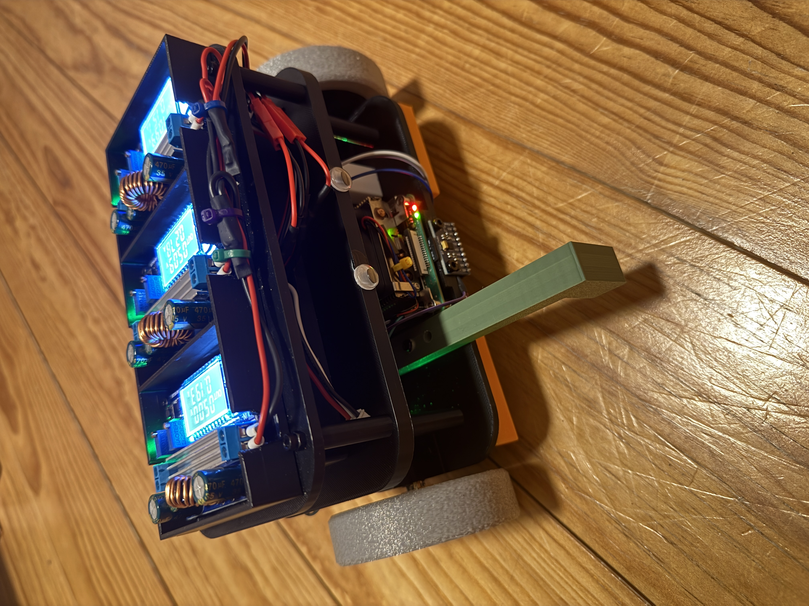
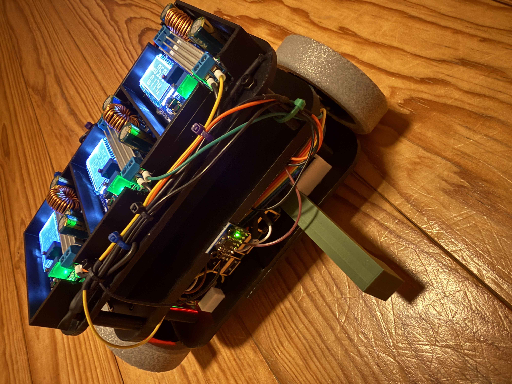
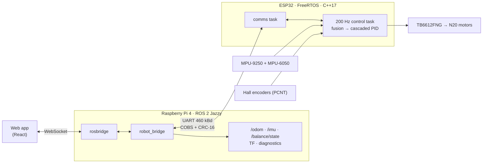
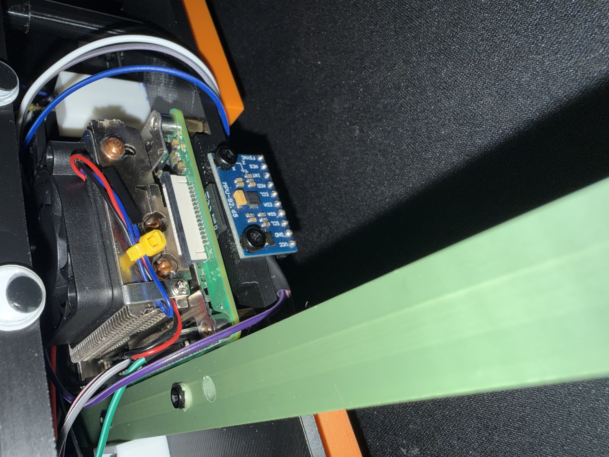
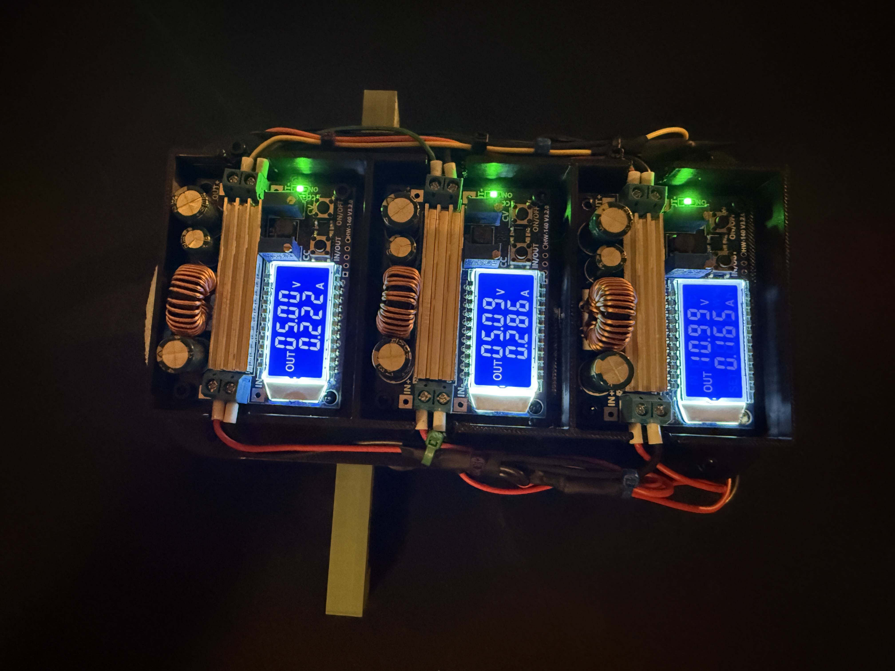

# ROS 2 Self-Balancing Differential-Drive Robot


[](https://github.com/dagebg/ros2-self-balancing-robot/actions/workflows/ci.yml)
[](https://dagebg.github.io/ros2-self-balancing-robot/)
[](https://github.com/dagebg/ros2-self-balancing-robot/actions/workflows/docker.yml)

> A personal learning project: a two-wheeled self-balancing robot built from scratch, with an
> ESP32 running the real-time balance loop, a Raspberry Pi 4 running ROS 2, and a 3D-printed
> chassis. All while working on my master's thesis, so updates might come irregularly.

**[Full documentation → dagebg.github.io/ros2-self-balancing-robot](https://dagebg.github.io/ros2-self-balancing-robot/)**

<p align="center">
  
  
</p>

## How it works



The ESP32 keeps the robot upright on its own: it fuses two IMUs, runs a cascaded controller
(velocity → lean angle → motor command, plus yaw rate) at 200 Hz and owns every safety decision.
The Pi only sends velocity targets and turns telemetry into ROS 2 topics; a browser drives,
arms and tunes the robot through rosbridge.

## Highlights

- **One control implementation, four places.** The balance controller, estimator, odometry and
  protocol are plain C++17 libraries (`shared/`) compiled into the ESP32 firmware, the ROS 2
  bridge, host unit tests and the simulator.
- **Software-in-the-loop with the real code.** In Gazebo, a *virtual ESP32* runs the firmware's own
  control and communication code behind the unchanged ROS 2 bridge over a pseudo-terminal. CI arms
  the simulated robot, keeps it balancing and drives it forward on every pull request.
- **Closed-loop tests before hardware.** A wheeled-inverted-pendulum model (Lagrangian dynamics,
  DC-motor curve) with noisy, biased, delayed sensors checks balancing, push recovery and velocity
  tracking. The default gains were chosen for robustness across ±30–40 % parameter error.
- **A protocol that survives a noisy UART.** COBS framing, CRC-16 and version and enum
  validation, with golden-byte tests, seeded fuzzing and an ASan/UBSan run.
- **Hardware behind interfaces.** Drivers for the IMUs, H-bridge and PCNT encoders are tested
  against fakes; one source file (`config/robot_params.yaml`) feeds the firmware, URDF and launch
  files, with compile-time checks.
- **Engineering process.** 13 architecture decision records, Sphinx + Doxygen docs built with
  warnings as errors, pre-commit, clang-tidy with the C++ Core Guidelines, a ≥ 90 % coverage gate
  on the shared code, Docker images for the Pi and tagged releases with flashable firmware.

## Quick start

Everything except the hardware runs on a laptop. Requirements: Docker, Node.js, Python 3.

```bash
# Simulation (Gazebo headless) with rosbridge published on port 9090
tools/ros-docker.sh colcon-build
ROS_DOCKER_ARGS="-p 9090:9090" tools/ros-docker.sh \
  "cd ros2_ws && source install/setup.bash && ros2 launch robot_sim sim.launch.py"

# Web app against the simulation: open http://localhost:5173/?ros=ws://localhost:9090
cd webapp && npm install && npm run dev
```

All checks that CI runs can be run locally; see
[Development environment](https://dagebg.github.io/ros2-self-balancing-robot/development/setup.html).

On the robot: flash the firmware (`pio run -e esp32 -t upload` in `firmware/esp32/robot-firmware`)
and start the Pi side with `docker compose -f docker/compose.yaml up -d`.

## Hardware

| Component | Role |
|---|---|
| Raspberry Pi 4B 4 GB | Main computer running ROS 2 |
| ESP32 DevKit C V4 | Real-time balance control, sensors, motors |
| 2× N20 100 RPM + Hall encoders | Drive wheels and wheel odometry |
| TB6612FNG dual motor driver | Motor direction and PWM |
| MPU-9250 9-DOF IMU | Primary IMU (lower deck, facing forward) |
| MPU-6050 6-DOF IMU | Secondary IMU (second deck, facing backward) |
| 2× 7.4 V 2000 mAh Li-Ion 2S | Main power source |
| 3× HW-140 DC-DC converter | 5.1 V (Pi), 5 V (ESP32), 11.5 V (motors) |
| 3D-printed chassis + wheels | Designed in Autodesk Fusion and Siemens NX, printed on a BambuLab P1S |

<p align="center">
  
  
  
</p>

The electronics are documented in KiCad
([schematic](mechanical_hardware/schematics/schematics.kicad_sch),
[PDF](mechanical_hardware/schematics/schematics.pdf)); the
[pinout](https://dagebg.github.io/ros2-self-balancing-robot/hardware/pinout.html) is derived from
the netlist.

## Repository layout

```text
ros2-self-balancing-robot/
├── firmware/esp32/robot-firmware/  ESP32 firmware (PlatformIO, Arduino-ESP32, FreeRTOS)
├── shared/                         portable C++17: robot_protocol, balance_core
├── ros2_ws/src/                    ROS 2: interfaces, bridge, description, bringup, sim
├── webapp/                         browser control panel (React, TypeScript, Vite)
├── config/robot_params.yaml        single source of robot constants
├── docker/                         Pi images, dev container, compose file
├── docs/                           Sphinx + Doxygen documentation, ADRs
├── tools/                          code generation, container and release helpers
└── mechanical_hardware/            CAD and KiCad schematics
```

## Status

| Area | State |
|---|---|
| Firmware, ROS 2 packages, web app, CI/CD, documentation | implemented and tested |
| Balancing, driving, arming, live tuning | verified in Gazebo with the firmware's own code |
| Hardware bring-up | next: measure the placeholders in `config/robot_params.yaml` with the [bring-up tool](https://dagebg.github.io/ros2-self-balancing-robot/hardware/bringup.html), then tune on the robot |

The [roadmap](https://dagebg.github.io/ros2-self-balancing-robot/overview/roadmap.html) and
[changelog](CHANGELOG.md) track progress.

## License

[MIT](LICENSE)
