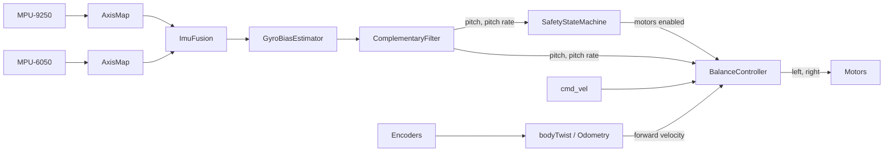
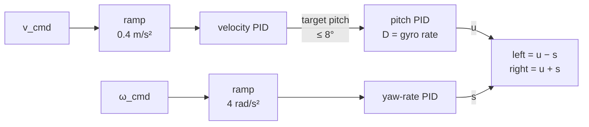
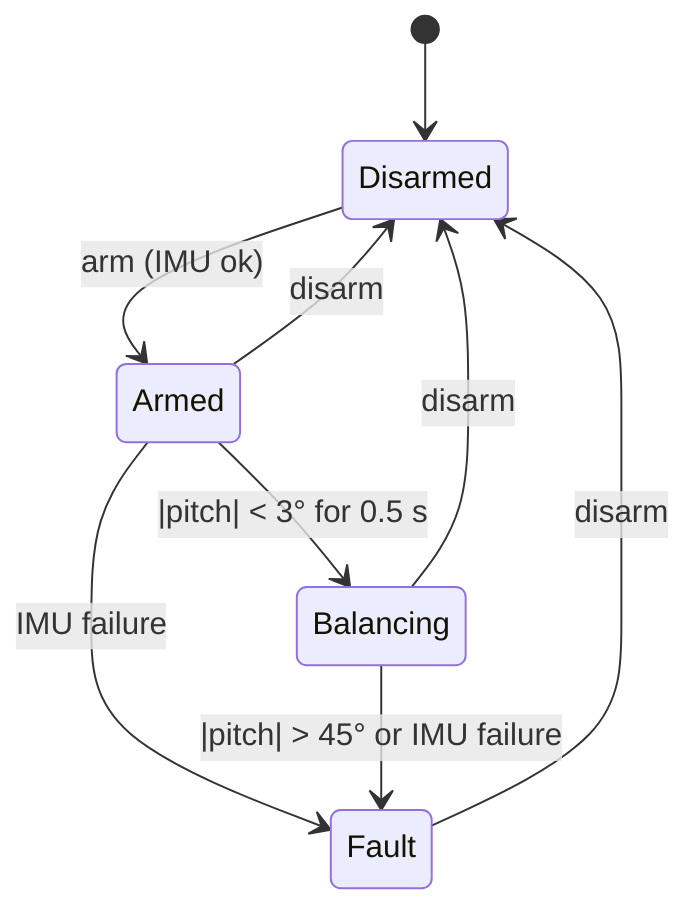

# Balance control

The control code lives in `shared/balance_core`: plain C++17 that runs unchanged on the ESP32, in
host unit tests and in the simulation (see {doc}`development/adr/0006-shared-core-libraries`).
This page explains what it computes and why.

## Conventions

All quantities follow REP-103: body x forward, y left, z up. Positive **pitch** tilts the nose
down (the robot leans forwards), positive **roll** lifts the left side, positive **yaw** turns
counter-clockwise seen from above. Motor commands are in [−1, 1], positive drives the wheel
forwards.

## Pipeline

## State estimation

**IMU fusion.** Both IMUs are rotated into the body frame (`AxisMap`, see
{doc}`firmware/drivers`). On a rigid body their angular rates must agree, so the gyroscopes serve
as a cross-check: while they agree within 0.35 rad/s per axis, both samples are averaged; if they
disagree for more than 50 ms, the MPU-9250 is used alone and a fault flag is raised. If one IMU
stops responding, the other carries on.

**Gyro bias.** Before arming, `GyroBiasEstimator` averages 2 s of samples while the robot stands
still. Any movement during the window restarts it.

**Complementary filter.** Pitch is predicted by integrating the gyro and corrected towards the
accelerometer's estimate:

$$
\hat\theta_k = \hat\theta_{k-1} + \omega_y \,\Delta t, \qquad
\hat\theta_k \leftarrow \hat\theta_k + \alpha\,(\theta_{acc} - \hat\theta_k), \qquad
\alpha = \frac{\Delta t}{\tau + \Delta t}
$$

with $\theta_{acc} = \operatorname{atan2}\!\big(-a_x, \sqrt{a_y^2 + a_z^2}\big)$ and
$\tau = 0.5\,\mathrm{s}$. The gyro dominates at high frequency, the accelerometer removes drift at
low frequency. The accelerometer also sees the robot's own acceleration; when the measured
specific force deviates from 1 g by more than 25 %, the correction is skipped for that sample. A
residual gyro offset $b$ leaves a steady pitch error of $b\,\tau$, which the unit tests check.

## The plant

The robot is a wheeled inverted pendulum. With axle position $x$ and pitch $\theta$ as
coordinates, the Lagrangian gives (body mass $M$, centre of mass at height $l$ above the axle,
body inertia $J$, wheel radius $r$, total motor torque $\tau_m$):

$$
\begin{aligned}
m_{\mathit{eff}}\,\ddot x + M l \cos\theta\,\ddot\theta &= \frac{\tau_m}{r} + M l \sin\theta\,\dot\theta^2 - c\,\dot x \\
M l \cos\theta\,\ddot x + (J + M l^2)\,\ddot\theta &= M g l \sin\theta - \tau_m
\end{aligned}
$$

The motor torque drives the wheels and reacts on the body with the opposite sign: accelerating
forwards tilts the body backwards. Each N20 motor follows the DC-motor line
$\tau = \tau_{stall}\,(u - \omega_{rel}/\omega_{0})$, where $\omega_{rel}$ is the wheel speed
relative to the chassis. `sim::WheeledPendulum` implements exactly these equations; the closed-loop
tests run the real controller against it.

Linearized around upright, the open loop has an unstable pole near
$\sqrt{g/l_{\mathit{eff}}} \approx 10\,\mathrm{rad/s}$ for the placeholder parameters, so the
controller needs a bandwidth well above that, at a 200 Hz loop rate with about 5 ms of sensor delay.

## Controller

**Why a cascade.** A two-wheeled robot cannot accelerate without first leaning into the motion.
The outer loop turns a velocity error into a lean angle; the inner loop turns the pitch error into
a motor command, which moves the wheels under or ahead of the centre of mass. Its D term uses the
gyroscope's pitch rate directly instead of differentiating a noisy angle. The comparison with a
state-space (LQR) controller is in {doc}`development/adr/0009-cascaded-pid-controller`.

**PID details.** Each loop is

$$
u = K_p\,e + \operatorname{clamp}\!\Big(\sum K_i\,e\,\Delta t\Big) - K_d\,\dot y
$$

- derivative on measurement ($\dot y$, not $\dot e$), so a setpoint step does not kick the output;
- integral clamped, and frozen while the output is saturated in the direction of the error
  (anti-windup);
- non-finite inputs leave the state untouched.

**Steering** is mixed differentially and is limited to the headroom the pitch loop leaves: when
the motors saturate, balance wins over turning.

**Commands** are clamped (0.2 m/s, 2 rad/s) and ramped. The 100 RPM motors reach only about
0.34 m/s at their rated voltage; the controller needs speed reserve beyond the commanded velocity
to catch the robot, so the velocity limit stays well below that.

### Default gains

| Loop | $K_p$ | $K_i$ | $K_d$ |
|---|---|---|---|
| Pitch (rad → command) | 28 | 5 | 0.1 |
| Velocity (m/s → rad) | 0.3 | 0.05 | 0 |
| Yaw rate (rad/s → command) | 0.12 | 0.4 | 0 |

These come from a grid search with the closed-loop model, choosing the gains with the best
*worst case* over 27 plant variants: body mass 0.65–1.2 kg, centre-of-mass height 5–11 cm and
motor torque ±33 %. Robustness matters more than performance while the real parameters are
unknown. The gains can be changed at runtime from the Pi.

## Safety

The motors run only in **Balancing**. Arming does not start the motors: the robot waits until it is
held upright, so it can be armed while lying on its stand. Faults latch; picking a fallen robot up
does not restart it until it is disarmed and armed again. When balancing starts, the controller is
reset so no integrator state from a previous run carries over.

## Odometry

The encoders sit on the motor shafts, which are fixed to the chassis, so they measure the wheel
rotation **relative to the chassis**. When the body pitches, the wheels turn relative to it even if
the robot stands still. The rotation over ground adds the pitch:

$$
v = r\,\frac{(\omega_L + \dot\theta) + (\omega_R + \dot\theta)}{2}, \qquad
\omega_z = r\,\frac{\omega_R - \omega_L}{b}
$$

with track width $b$. `Odometry` integrates the pose with midpoint integration and applies the same
pitch correction to wheel angle increments. The ROS 2 bridge uses the same class to publish
`/odom`.

## Verification

| Test | What it shows |
|---|---|
| Sign tests | Leaning forwards drives forwards; CCW yaw speeds up the right wheel; saturation gives balance priority |
| `StaysUpright` | 10 s with noise, bias and delay: pitch < 2°, drift < 0.2 m |
| `RecoversFromInitialTilt` | Settles within 0.5° in 3 s |
| `RejectsAPush` | 0.6 rad/s push: peak < 15°, back within 1° |
| `TracksForwardVelocity` | 0.15 m/s within ±0.03 m/s, then stops |
| `TurnsOnTheSpot` | 1 rad/s yaw within ±0.2 rad/s while balancing |
| `RobustnessTest` | Default gains survive mass, centre-of-mass and torque errors |
| `MotorsTooWeak…` | A robot that cannot be held ends in a latched tilt fault with motors off |
