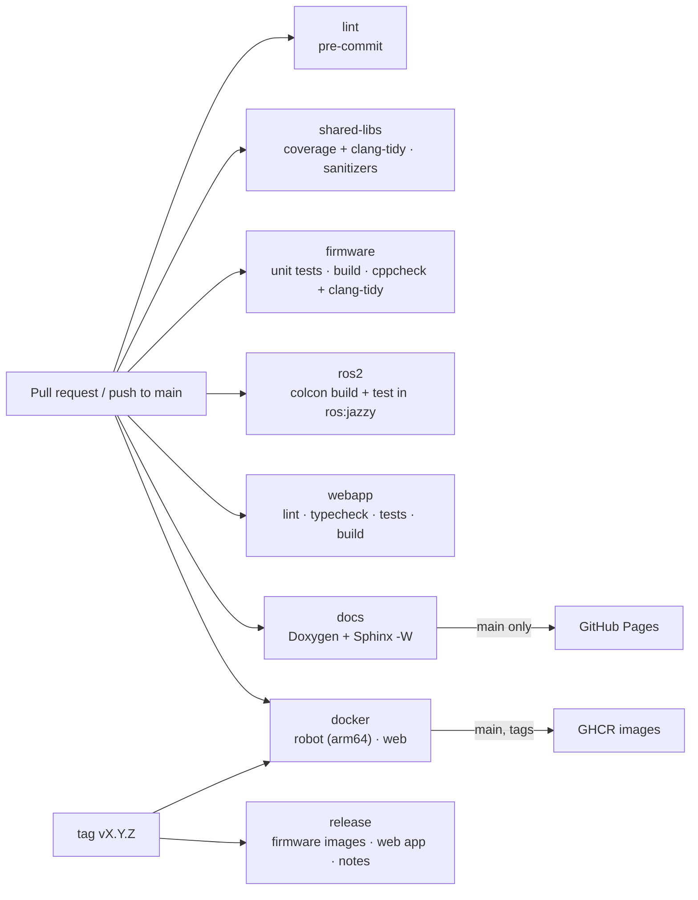

# CI/CD pipeline

All checks run on GitHub Actions for every pull request and every push to `main`. Each check can
be reproduced locally with the same pinned tools (see {doc}`setup`).

## Workflows

| Workflow | Trigger | Jobs |
|---|---|---|
| `ci.yml` | Pull requests, push to `main` | `lint`, `shared-libs` (2 variants), `firmware`, `ros2`, `webapp` |
| `docs.yml` | Pull requests, push to `main` | Build docs with warnings as errors; deploy to GitHub Pages from `main` |
| `docker.yml` | Pull requests touching the images, push to `main`, tags | Build the robot (arm64) and web images; push to GHCR except for pull requests |
| `release.yml` | Tags `vX.Y.Z` | Firmware flash images, web app bundle and release notes as a GitHub Release (see {doc}`releasing`) |

## Jobs

**lint** runs `pre-commit run --all-files`, the same hooks that run locally on each commit:
whitespace and line-ending fixes, YAML/TOML/JSON validation, a large-file guard, `ruff` lint and
format for Python, `clang-format` for C++ and a check that the generated `robot_config.hpp`
matches `config/robot_params.yaml`. It then runs the Python tool tests with `pytest`.

**shared-libs** builds the libraries in `shared/` with warnings as errors in two variants. The
*coverage* variant runs the tests, clang-tidy (every check an error) and gcovr, fails below 90 %
line coverage, and publishes the summary and an HTML report. The *sanitizers* variant runs the
same tests under AddressSanitizer and UndefinedBehaviorSanitizer.

**firmware** runs the host unit tests (`pio test -e native`), builds the ESP32 image with
placeholder credentials, writes the RAM/flash usage to the job summary, runs cppcheck and
clang-tidy (failing on any high- or medium-severity finding) and uploads `firmware.bin` and
`firmware.elf` as artifacts.

**ros2** runs in the official `ros:jazzy` container: `rosdep` installs the dependencies declared in
the `package.xml` files, then colcon builds and tests the ROS 2 packages together with the shared
libraries, and the JUnit results are uploaded.

**webapp** runs ESLint and Prettier, the TypeScript compiler, the Vitest unit and component tests,
and the production build, and uploads `webapp/dist`.

**docs** generates Doxygen XML, builds Sphinx with `-W`, uploads the HTML as an artifact and, on
`main`, publishes it to GitHub Pages.

**docker** builds the robot image natively on an Arm runner and the multi-architecture web image,
with layer caches in GitHub Actions; see {doc}`../deployment/docker`.

**release** builds the firmware and bring-up images, merges each into one flashable file, builds
the web app, generates release notes from the Conventional Commits with git-cliff and publishes a
GitHub Release.

## Conventions

- Concurrency groups cancel superseded runs on the same branch.
- Python and npm dependencies are pinned and cached; Dependabot proposes grouped updates for
  actions, Python tools and the web app.
