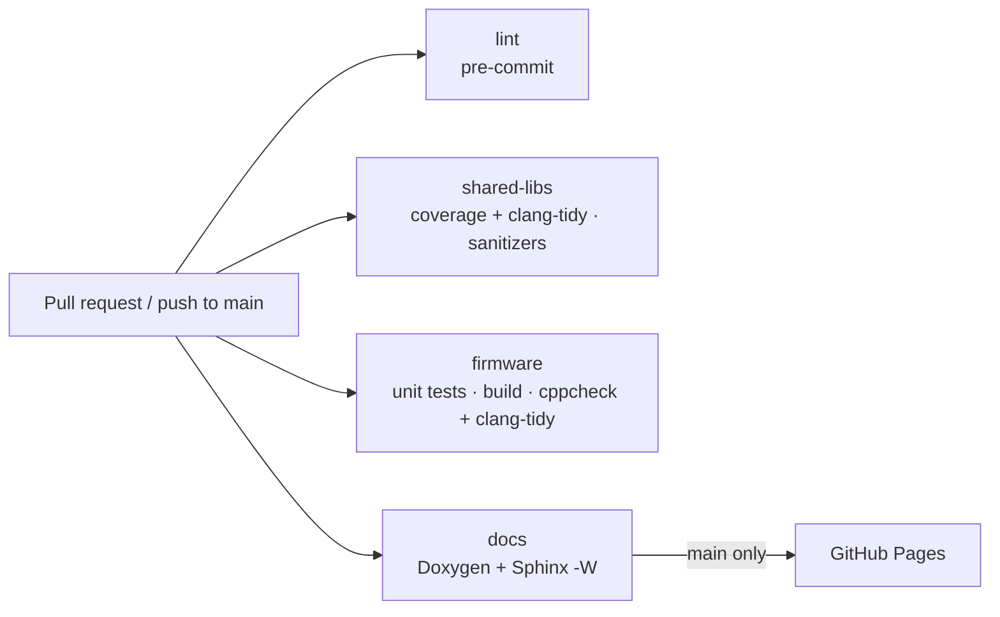

# CI/CD pipeline

All checks run on GitHub Actions for every pull request and every push to `main`. Each check can
be reproduced locally with the same pinned tools (see {doc}`setup`).

## Workflows

| Workflow | Trigger | Jobs |
|---|---|---|
| `ci.yml` | Pull requests, push to `main` | `lint`, `shared-libs` (2 variants), `firmware` |
| `docs.yml` | Pull requests, push to `main` | Build docs with warnings as errors; deploy to GitHub Pages from `main` |

## Jobs

**lint** runs `pre-commit run --all-files`, the same hooks that run locally on each commit:
whitespace and line-ending fixes, YAML/TOML/JSON validation, a large-file guard, `ruff` lint and
format for Python, `clang-format` for C++ and a check that the generated `robot_config.hpp`
matches `config/robot_params.yaml`. It then runs the Python tool tests with `pytest`.

**shared-libs** builds the libraries in `shared/` with warnings as errors in two variants. The
*coverage* variant runs the tests, clang-tidy (every check an error) and gcovr, fails below 90 %
line coverage, and publishes the summary and an HTML report. The *sanitizers* variant runs the
same tests under AddressSanitizer and UndefinedBehaviorSanitizer.

**firmware** runs the host unit tests (`pio test -e native`), builds the ESP32 image with
placeholder credentials, writes the RAM/flash usage to the job summary, runs cppcheck and
clang-tidy (failing on any high- or medium-severity finding) and uploads `firmware.bin` and
`firmware.elf` as artifacts.

**docs** generates Doxygen XML, builds Sphinx with `-W`, uploads the HTML as an artifact and, on
`main`, publishes it to GitHub Pages.

## Conventions

- Concurrency groups cancel superseded runs on the same branch.
- Python dependencies are pinned and cached; Dependabot proposes updates for actions and Python
  tools.
- Jobs are added to this page as new parts of the system land.
