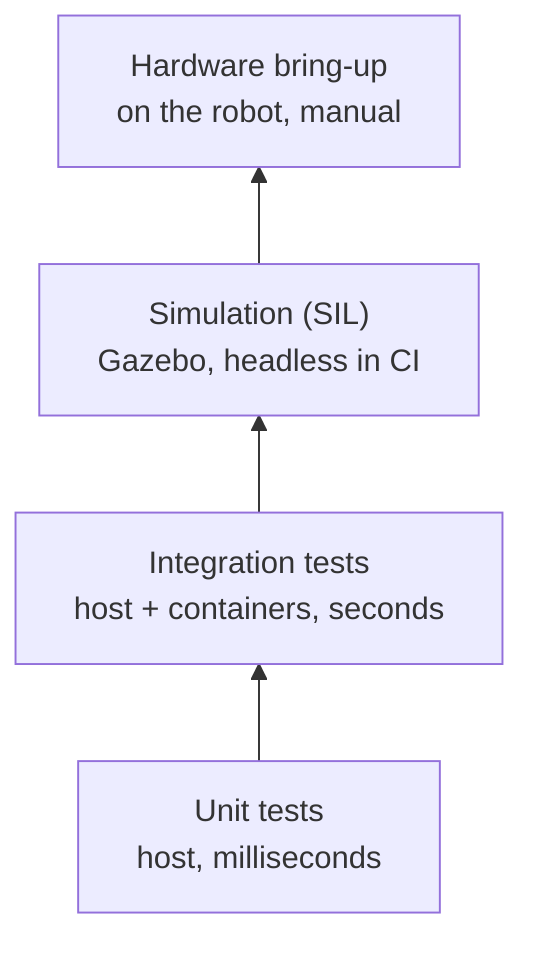

# Testing strategy

A balancing robot that falls over is a poor debugging tool. Most behavior is therefore verified
off the robot, and the hardware is the last step, not the first.

## Layers

| Layer | What it covers | Where it runs |
|---|---|---|
| Unit | Protocol codec, filters, controllers, kinematics, drivers against fake buses | Host (macOS/Linux) and CI |
| Closed loop | The balance controller against a wheeled-pendulum model with noisy, biased, delayed sensors | Host and CI |
| Integration | The ROS 2 bridge node against a fake ESP32 on a pseudo-terminal; the bringup launch file without hardware (launch_testing) | `ros:jazzy` container and CI |
| Simulation | Gazebo with a virtual ESP32 running the firmware's control and comms code behind the real bridge: arming, balancing, driving | Gazebo Harmonic, headless, CI |
| Hardware | IMU orientation, motor direction, encoder counts, final tuning | Robot, with the bring-up firmware |

## Principles

- **Hardware behind interfaces.** Firmware logic talks to small interfaces (I2C bus, PWM output,
  counter, clock) rather than to Arduino directly. Tests supply fakes that record and replay bus
  traffic.
- **One implementation, tested once, used everywhere.** The protocol codec and the balance core
  are plain C++17 libraries shared by the firmware, the ROS 2 bridge and the simulator.
- **Closed-loop tests.** Controllers are tested against a plant model (an inverted pendulum on
  wheels), not just for individual outputs, so a test fails if the robot would fall.
- **Same tools locally and in CI.** Every CI job is reproducible with the commands in
  {doc}`setup`.
- **Sanitizers and coverage for shared code.** The shared libraries run their tests a second time
  under AddressSanitizer and UndefinedBehaviorSanitizer, and CI fails below 90 % line coverage.
- **Robustness by randomization.** Codecs are exercised with seeded random inputs (COBS round
  trips across block boundaries, garbage bursts in front of valid frames, every single-bit flip
  of a frame), so failures are reproducible from the seed.

## Frameworks

GoogleTest is used for all C++ tests: PlatformIO's native test runner for firmware, CMake/CTest
for the shared libraries, and `ament_cmake_gtest` for ROS 2 packages. Python launch tests use
`launch_testing`, and the web app uses Vitest with Testing Library; its network client has an
opt-in integration test against a running simulation.
