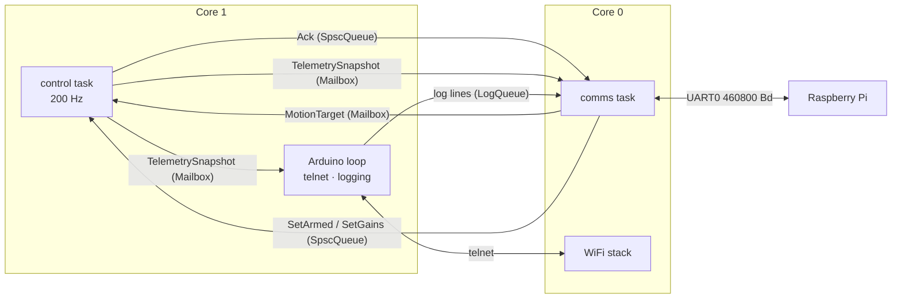

# Firmware architecture

The firmware separates **what** it computes from **when and where** it runs. All decisions live
in portable classes; `src/main.cpp` only connects them to the hardware and to FreeRTOS (see
{doc}`../development/adr/0010-firmware-task-split`).

## Tasks

| Task | Core | Priority | Period | Responsibility |
|---|---|---|---|---|
| `control` | 1 | highest application priority | 5 ms (`vTaskDelayUntil`) | read sensors, run `ControlLoop`, drive motors |
| `comms` | 0 | medium | 2 ms | UART protocol, telemetry, acknowledgements, log forwarding |
| Arduino `loop` | 1 | lowest | 20 ms | telnet, state-change logging, link statistics |

WiFi runs on core 0 as well, so the control task has core 1 to itself apart from the idle-priority
Arduino loop.

## Data exchange between tasks

| Channel | Type | Why this type |
|---|---|---|
| Velocity target and link liveness | `Mailbox<MotionTarget>` | only the latest value matters |
| Telemetry snapshot | `Mailbox<TelemetrySnapshot>` | only the latest value matters |
| Arm / gain commands | `SpscQueue<Request, 8>` | every command must be executed once and acknowledged |
| Acknowledgements | `SpscQueue<Ack, 8>` | every result must reach the Pi |
| Log lines | `LogQueue` (mutex, bounded) | any task may log; lines are dropped rather than blocking |

`SpscQueue` is lock-free (acquire/release atomics on head and tail), so the control task never
waits on the comms task. A unit test pushes 200 000 elements through it from a second thread and
checks order and completeness.

## One control tick

1. Read both IMUs (one 14-byte I2C burst each, about 0.4 ms at 400 kHz) and both PCNT counters.
2. Execute queued commands and push their acknowledgements.
3. Read the velocity target; the link counts as alive if anything arrived in the last 500 ms.
4. `ControlLoop::step()`: mounting → bias → fusion → attitude → safety → odometry → controller.
5. Apply the motor commands, or coast both motors and pull STBY low when not balancing.
6. Publish the telemetry snapshot, record the tick's duration and feed the task watchdog.

The control task never logs and never touches WiFi, because both can block. State changes are
noticed and logged by the Arduino loop, which watches the telemetry snapshot.

## Failure handling

| Situation | Reaction |
|---|---|
| An IMU is missing at boot | logged; the other IMU carries on alone |
| Both IMUs fail while balancing | fault latched, motors off |
| No frame from the Pi for 500 ms | velocity targets go to zero, the robot keeps balancing in place, `kLinkTimeout` flag set |
| Tick longer than its period | `kLoopOverrun` flag, longest tick reported in telemetry |
| Control task hangs | task watchdog (1 s) panics and reboots; `setup()` disables the motors first thing |
| Command queue full | command dropped and counted; the Pi sees no Ack and can retry |

## Start-up sequence

1. Motors off: STBY low, both channels coasting.
2. Logger with telnet and protocol sinks; WiFi access point.
3. UART0 at 460 800 Bd and a lone `0x00`, so the Pi's parser discards boot-ROM output.
4. I2C scan, IMU initialization, PCNT encoders.
5. Task watchdog set to 1 s; control and comms tasks started.

After start-up the gyro bias is calibrated automatically whenever the robot is disarmed and still
for 2 s; arming is refused until it is.

## Testing

`ControlLoop` and `CommsService` are plain classes, so the host tests drive them directly:

- `test_control_loop` closes the loop with the wheeled-pendulum plant, feeding IMU readings in
  *sensor* axes through non-trivial mountings and raw encoder counts with one encoder wired
  reversed: the firmware's whole data path from bias calibration to motor commands.
- `test_comms` feeds encoded frames into a fake UART and checks routing, acknowledgements, the
  telemetry rate and log forwarding.
