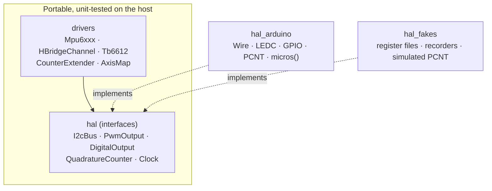

# Hardware abstraction and drivers

Drivers never call Arduino or ESP-IDF functions directly. They depend on five small interfaces in
`lib/hal`; the ESP32 implements them in `lib/hal_arduino`, and the unit tests use fakes from
`lib/hal_fakes`. Everything in `lib/drivers` is therefore plain C++ that runs on the host.

## IMUs: `Mpu6xxx`

One driver serves both IMUs: the MPU-6050 and MPU-9250 share the accelerometer/gyroscope register
map and differ only in their WHO_AM_I value, an extra accelerometer filter register and the
temperature formula (see {doc}`../development/adr/0007-own-imu-driver`).

| Setting | Value | Why |
|---|---|---|
| Sample rate | 200 Hz (`SMPLRT_DIV` = 4) | Matches the control loop |
| Digital low-pass filter | ~42 Hz gyro and accel | Removes motor vibration, adds ~5 ms delay |
| Accelerometer range | ±4 g (8192 LSB/g) | Headroom for bumps without losing resolution |
| Gyroscope range | ±500 °/s (65.5 LSB/(°/s)) | A falling robot stays well below this |
| Clock source | PLL with gyro X | More stable than the internal oscillator |

`begin()` checks WHO_AM_I before writing anything, resets the chip and applies the configuration.
`read()` fetches all 14 data bytes in one burst, so every axis comes from the same instant, and
converts to m/s², rad/s and °C. The magnetometer inside the MPU-9250 is not used.

## Motors: `HBridgeChannel` and `Tb6612`

`HBridgeChannel` drives one TB6612 channel from a command in [−1, 1]:

| Command | IN1 | IN2 | PWM |
|---|---|---|---|
| > 0 (forward) | H | L | `command × max_duty` |
| < 0 (reverse) | L | H | `|command| × max_duty` |
| 0 or NaN | L | L (coast) | 0 |
| `brake()` | H | H (short brake) | 0 |

- `max_duty` = rated motor voltage / supply voltage limits the effective motor voltage; the
  motors run from an 11.5 V rail.
- PWM is set to zero before the direction pins change.
- An `inverted` flag swaps directions for a mirrored motor.
- `Tb6612` owns the shared standby pin: while it is disabled, no channel can drive, whatever its
  inputs. The application uses it as the motors' master switch.

PWM runs at 20 kHz (inaudible) with 10-bit resolution on the ESP32 LEDC peripheral.

## Encoders: PCNT and `CounterExtender`

Each wheel encoder is decoded in hardware by one PCNT unit with two channels, counting every edge
of both phases (×4 decoding) without any CPU interrupts (see
{doc}`../development/adr/0008-pcnt-quadrature-decoding`). The PCNT glitch filter ignores pulses
shorter than 1.25 µs, which also covers the ESP32 erratum that produces spurious pulses on
GPIO 36.

The PCNT counter is 16-bit and resets to zero at ±30000. `CounterExtender` turns successive raw
values into a 32-bit running total: it folds each difference into (−15000, 15000]. At the highest
expected wheel speed the count changes by a few hundred per 5 ms control period, far below that
bound. The tests run it against a simulated PCNT through several resets in both directions and a
2000-step random walk.

## Mounting: `AxisMap` and `board.hpp`

`AxisMap` converts a vector from an IMU's own axes into the robot body frame (x forward, y left,
z up). It is built from three codes taken from `config/robot_params.yaml`, for example
`{-1, -2, 3}` for a sensor turned 180° about z. Only the 24 proper rotations are accepted: a
mirror image cannot result from mounting a sensor, so it would indicate a typo.

`include/board.hpp` resolves all wiring parameters (motor channels, encoder connectors, inversions,
IMU mountings, duty limit) at compile time. Each value is checked with a `static_assert`, so an
invalid entry in `robot_params.yaml` stops the build with a message naming the parameter.

## Bring-up tool

`pio run -e bringup -t upload` flashes a separate application that exercises every driver
interactively; see {doc}`../hardware/bringup`.
