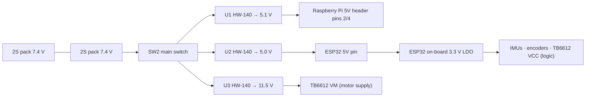

# Power system

The robot uses a multi-rail power architecture with a dedicated converter per subsystem, so motor
current spikes cannot brown out the computers.

```{image} ../../img/buck_converters.JPG
:width: 55%
:alt: The three DC-DC converters
```

## Rails



| Rail | Source | Consumers |
|---|---|---|
| Battery | Two 2S Li-Ion packs, wired in series in the schematic | DC-DC inputs via SW2 |
| 5.1 V | U1 | Raspberry Pi (through the 5V header pins) |
| 5.0 V | U2 | ESP32 DevKitC `5V` pin |
| 11.5 V | U3 | TB6612FNG `VM`, i.e. the motors |
| 3.3 V | ESP32 on-board regulator | MPU-9250, MPU-6050, both encoders, TB6612 `VCC` logic |

All grounds are common.

## Notes

- Feeding the Pi through the 5V header bypasses its USB-C input protection, which is why the
  rail is set slightly high (5.1 V) to cover cable losses.
- The motor rail (11.5 V) is higher than many N20 variants are rated for. Until the motor rating is
  confirmed, the firmware limits the maximum PWM duty cycle (see the calibration guide).
- There is no battery-voltage measurement yet; see {doc}`known-issues`.
