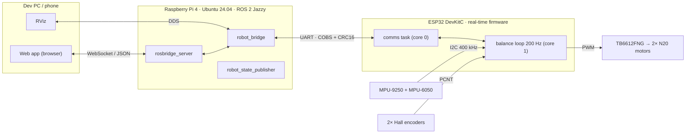

# Architecture

The robot is split into a **real-time layer** on the ESP32 and a **high-level layer** on the
Raspberry Pi. The ESP32 keeps the robot upright on its own; the Pi only sends velocity targets and
never has to know how the balance loop works.

## Components

| Layer | Hardware | Software |
|---|---|---|
| Development | Fedora desktop, MacBook | Build, flash, SSH, RViz, web app |
| High level | Raspberry Pi 4 Model B 4 GB | Ubuntu Server 24.04, ROS 2 Jazzy |
| Real time | ESP32 DevKitC V4 (AZ-Delivery) | Arduino-ESP32 + FreeRTOS, C++17 |
| Actuation | TB6612FNG, 2× N20 motors with Hall encoders | Firmware motor + encoder drivers |
| Sensing | MPU-9250 (lower deck), MPU-6050 (second deck) | Firmware IMU driver + sensor fusion |
| Mechanics | 3D-printed chassis and wheels | Fusion 360 / Siemens NX, BambuLab P1S |

See {doc}`../hardware/index` for the bill of materials, pinout and power system.

## Responsibilities

**ESP32 (real-time layer)**

- Reads both IMUs and both wheel encoders.
- Estimates pitch and runs the cascaded balance controller at a fixed 200 Hz rate.
- Drives the motors through the TB6612FNG.
- Owns all safety decisions: arming, tilt cut-off and command timeouts.
- Exchanges framed binary messages with the Pi over UART (see
  {doc}`../development/adr/0003-custom-uart-protocol`).

**Raspberry Pi (high-level layer)**

- Subscribes to `/cmd_vel` and forwards velocity targets to the ESP32.
- Publishes IMU, odometry, TF and wheel joint states from ESP32 telemetry.
- Hosts `rosbridge_server` so the web app can drive and tune the robot from a browser.

## Connections

| Link | Transport | Purpose |
|---|---|---|
| Pi ↔ ESP32 | UART (Pi GPIO14/15 ↔ ESP32 UART0) | Commands, telemetry, logs |
| ESP32 → dev PC | WiFi SoftAP + telnet (port 23) | Debug log stream |
| Fedora PC ↔ Pi | Direct Ethernet with NAT | SSH and internet during development, see {doc}`../deployment/networking` |
| Browser ↔ Pi | WebSocket (rosbridge) | Web app control panel |

Status of each piece is tracked in the {doc}`roadmap`.
