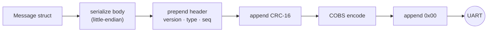

# ESP32 ↔ Pi protocol (v1)

The ESP32 and the Raspberry Pi exchange small binary messages over UART
(460 800 Bd, 8N1, Pi GPIO 14/15 ↔ ESP32 UART0). Both ends use the same C++17 implementation,
`shared/robot_protocol`, so encoder and decoder cannot disagree. The design rationale is in
{doc}`development/adr/0003-custom-uart-protocol`.

## Framing

```text
frame  = COBS( packet ) 0x00
packet = version:u8  type:u8  sequence:u8  body:bytes  crc:u16le
```



- **Delimiter:** `0x00` ends every frame. COBS guarantees it never appears inside a frame.
- **Integrity:** CRC-16/CCITT-FALSE (poly `0x1021`, init `0xFFFF`, no reflection, no final XOR)
  over header and body, little-endian. Check value: `"123456789"` → `0x29B1`.
- **Byte order:** every multi-byte field is little-endian; floats are IEEE-754 binary32.
- **Sequence:** each sender increments an 8-bit counter per frame. Receivers count gaps to
  detect loss (after an ESP32 reset the counter restarts, which shows up as one gap).
- **Size limit:** the largest frame is 104 bytes including the delimiter.

### Resynchronization

A receiver accumulates bytes until `0x00`, then decodes. Anything malformed — boot-ROM text,
line noise, a frame cut short by a reset — fails COBS, length or CRC checks, is counted and
dropped, and decoding resumes after the next delimiter. A run of more than 104 bytes without a
delimiter is discarded as an overflow. Empty frames (consecutive `0x00`) are ignored, so a sender
may emit a lone `0x00` to make sure the next frame starts cleanly; the firmware does this right
after opening the UART at start-up.

### Link supervision

The Pi must send a frame (normally `CmdVel`, otherwise `Heartbeat`) at least every 500 ms. If
nothing arrives for longer, the ESP32 treats the link as lost: the velocity targets drop to zero,
the robot keeps balancing on the spot, and telemetry carries the `kLinkTimeout` flag until frames
arrive again.

## Messages

Type identifiers `0x01`–`0x3F` travel Pi → ESP32, `0x40`–`0x7F` ESP32 → Pi. Offsets are within the
body.

### Pi → ESP32

| Type | Message | Body | Purpose |
|---|---|---|---|
| `0x01` | `Heartbeat` | empty | Keeps the link alive when no other command is due |
| `0x02` | `CmdVel` | 8 bytes | Body velocity target |
| `0x03` | `SetArmed` | 1 byte | Arm or disarm the motors; answered with `Ack` |
| `0x04` | `SetGains` | 13 bytes | Replace one loop's PID gains; answered with `Ack` |

| Message | Offset | Field | Type | Unit / values |
|---|---|---|---|---|
| `CmdVel` | 0 | `linear_x` | f32 | m/s, forward positive |
| | 4 | `angular_z` | f32 | rad/s, counter-clockwise positive |
| `SetArmed` | 0 | `armed` | u8 | 0 = disarm, 1 = arm |
| `SetGains` | 0 | `loop` | u8 | 0 = pitch, 1 = velocity, 2 = yaw rate |
| | 1 | `kp` | f32 | |
| | 5 | `ki` | f32 | |
| | 9 | `kd` | f32 | |

### ESP32 → Pi

| Type | Message | Body | Purpose |
|---|---|---|---|
| `0x40` | `Telemetry` | 49 bytes | Controller state at the telemetry rate |
| `0x41` | `ImuSample` | 29 bytes | One calibrated IMU reading |
| `0x42` | `Log` | 1–97 bytes | One firmware log line |
| `0x43` | `Ack` | 3 bytes | Result of `SetArmed` / `SetGains` |

| Message | Offset | Field | Type | Unit / values |
|---|---|---|---|---|
| `Telemetry` | 0 | `timestamp_us` | u32 | ESP32 monotonic µs, wraps after ~71 min |
| | 4 | `state` | u8 | 0 disarmed, 1 armed, 2 balancing, 3 fault |
| | 5 | `faults` | u16 | bit 0 tilt limit, 1 IMU failure, 2 link timeout, 3 IMU disagreement, 4 loop overrun |
| | 7 | `roll` | f32 | rad |
| | 11 | `pitch` | f32 | rad, positive = nose down (REP-103) |
| | 15 | `pitch_rate` | f32 | rad/s |
| | 19 | `yaw_rate` | f32 | rad/s |
| | 23 | `left_ticks` | i32 | cumulative encoder count, ×4 decoding |
| | 27 | `right_ticks` | i32 | cumulative encoder count, ×4 decoding |
| | 31 | `left_wheel_velocity` | f32 | rad/s |
| | 35 | `right_wheel_velocity` | f32 | rad/s |
| | 39 | `left_duty` | f32 | motor command, −1 … 1 |
| | 43 | `right_duty` | f32 | motor command, −1 … 1 |
| | 47 | `max_loop_time_us` | u16 | longest control-loop iteration since the last report |
| `ImuSample` | 0 | `timestamp_us` | u32 | µs |
| | 4 | `sensor` | u8 | 0 MPU-9250, 1 MPU-6050 |
| | 5 | `accel[3]` | f32 × 3 | m/s², robot body frame |
| | 17 | `gyro[3]` | f32 × 3 | rad/s, robot body frame |
| `Log` | 0 | `level` | u8 | 0 debug, 1 info, 2 warn, 3 error |
| | 1 | `text` | 0–96 bytes | UTF-8, not null-terminated; length implied by the body size |
| `Ack` | 0 | `acked_type` | u8 | type of the acknowledged command |
| | 1 | `acked_sequence` | u8 | its sequence number |
| | 2 | `status` | u8 | 0 ok, 1 rejected in current state, 2 invalid |

## Validation

A decoder rejects, counts and drops a frame when:

| Error | Cause |
|---|---|
| `kCobs` | Invalid COBS encoding |
| `kTooShort` | Fewer than 5 bytes after COBS decoding |
| `kCrcMismatch` | Checksum does not match |
| `kUnsupportedVersion` | Version byte is not 1 |
| `kUnknownType` | Unknown type identifier |
| `kBadLength` | Body size does not match the type |
| `kBadValue` | An enum field is out of range |
| `kOverflow` | No delimiter within the maximum frame size |

Out-of-range enum values are rejected rather than cast, so a corrupted state byte can never turn
into an undefined enum value in either program.

## Link budget

At 460 800 Bd one byte takes about 21.7 µs.

| Stream | Frame size | Rate | Load |
|---|---|---|---|
| `Telemetry` | 56 B | 50 Hz | 2.8 kB/s (6 %) |
| `ImuSample`, IMUs alternating | 36 B | 50 Hz | 1.8 kB/s (4 %) |
| `CmdVel` from the Pi | 15 B | ≤ 50 Hz | 0.8 kB/s (2 %) |

The link stays below 20 % utilization, leaving room for log frames and retries.

## Versioning

- Adding a **new message type** is backward compatible: older receivers count it as an unknown
  type and drop it.
- Changing the **layout or meaning** of an existing message requires incrementing
  `kProtocolVersion`. Frames with another version are rejected, so mismatched firmware and Pi
  software fail loudly instead of misinterpreting data.
- The golden-bytes test in `test_codec.cpp` pins the wire format; it has to be updated
  deliberately together with the version.
