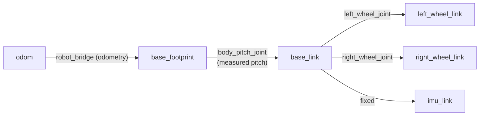

# robot_description

A URDF model built from simple shapes. Every dimension and mass comes from
`config/robot_params.yaml`, which the package installs next to the model, so the model always
matches the firmware and the bridge.

```bash
ros2 launch robot_description display.launch.py   # model + joint sliders in RViz
```

## Frames



| Frame | Where | Moves with |
|---|---|---|
| `base_footprint` | on the ground below the axle | the robot's planar pose (from `odom`) |
| `base_link` | centre of the axle | body pitch |
| `left/right_wheel_link` | wheel centres | wheel rotation relative to the chassis |
| `imu_link` | above the axle, axes aligned with `base_link` | the body |

**Why body pitch is a joint.** A balancing robot's body is never level. `body_pitch_joint`
between `base_footprint` and `base_link` lets `robot_bridge` publish the measured pitch as a
joint state, so `robot_state_publisher` tilts the model in RViz exactly as the robot leans. The
wheel joints sit on the pitching `base_link`, which is why their angles are relative to the chassis,
the same quantity the encoders measure.

## Simulation mode

`xacro robot.urdf.xacro sim:=true` drops `base_footprint` and `body_pitch_joint`. `base_link`
becomes a free-floating root, so physics, not a joint state, decides the pitch in Gazebo. It also
adds `robot.gazebo.xacro`: an IMU sensor on `base_link` (200 Hz), wheel friction, joint-state
publishing, a torque input per wheel and a ground-truth odometry publisher (see
{doc}`simulation`).

## Tests

`test_urdf.py` expands the model in both modes and checks the frame tree, the wheel joints and that
track width, wheel radius and body mass equal the values in `robot_params.yaml`.
