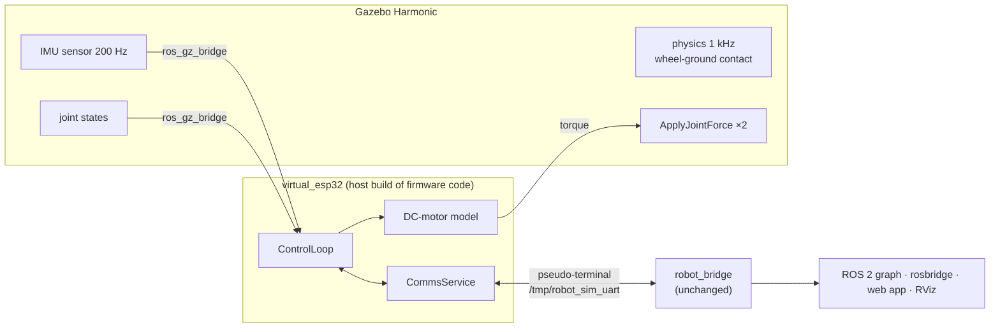

# Simulation

`robot_sim` runs the robot in Gazebo Harmonic **without replacing any of the robot's software
above the hardware**. A *virtual ESP32* runs the firmware's own `ControlLoop` and `CommsService`,
compiled for the host, and talks to the unchanged `robot_bridge` over a pseudo-terminal, exactly as
the real ESP32 does over its UART (see {doc}`../development/adr/0011-virtual-esp32-simulation`).

```bash
tools/ros-docker.sh ros2 launch robot_sim sim.launch.py              # headless, in the container
ros2 launch robot_sim sim.launch.py gui:=true rviz:=true             # on a Linux desktop
```



## What is real and what is simulated

| Layer | In simulation |
|---|---|
| Physics, IMU, encoders | Gazebo (IMU on `base_link`, wheel joint angles quantized to encoder counts) |
| Motors | DC-motor curve `τ = τ_stall (u − ω_rel/ω₀)`, same as `balance_core`'s plant model |
| Bias calibration, fusion, estimator, safety, controller, odometry | **firmware code** (`ControlLoop`) |
| Protocol, telemetry, acknowledgements, link supervision | **firmware code** (`CommsService`) over a pseudo-terminal |
| Bridge, model, bringup, rosbridge | **unchanged** ROS 2 packages |

The simulated robot spawns upright. On the real robot a hand holds it while it is armed; in
simulation the virtual ESP32 arms itself as soon as its gyro is calibrated (`auto_arm:=true`, the
default), so it starts balancing before it can tip over. After disarming, the robot falls and stays
down; restart the simulation to stand it up again.

## Launch arguments

| Argument | Default | Meaning |
|---|---|---|
| `gui` | `false` | Gazebo window (needs a display) |
| `rviz` | `false` | RViz with the robot view |
| `rosbridge` | `true` | WebSocket API, so the web app can drive the simulated robot |
| `auto_arm` | `true` | arm after calibration |

## The end-to-end test

`test_sim_balance.py` (launch_testing) starts the headless simulation and checks, through public
interfaces only:

1. telemetry arrives on `/balance/state` (Gazebo → firmware code → serial protocol → bridge);
2. the robot arms, and `/robot_bridge/arm` is acknowledged by the firmware code;
3. it balances for 8 s with |pitch| < 10°;
4. with `cmd_vel` at 0.1 m/s for 6 s, Gazebo's ground truth shows more than 25 cm of travel while
   it keeps balancing.

It runs in CI as part of the ROS 2 job.
